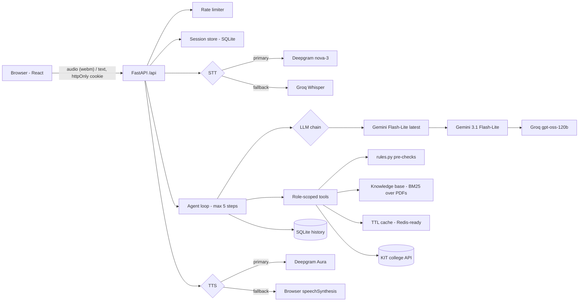

# KIT Voice Assistant

A real-time **voice assistant for Knotopian Institute of Technology (KIT)**. Applicants talk to it on the public home page. Students and teachers log in and use the same assistant for their own college services. Every conversation is saved and shown on a History page.

**Stack:** FastAPI (Python 3.11, async httpx) · React + Vite · Gemini (function calling) · Deepgram (STT + TTS) · Groq (fallback LLM and Whisper STT) · SQLite.

## Features vs requirements

| Requirement | Status | How |
|---|---|---|
| **Voice conversation** (must) | ✅ | MediaRecorder (webm/opus) with automatic end-of-speech detection → backend → **Deepgram nova-3** STT → agent → **Deepgram Aura** TTS (mp3). No Web Speech API recognition. |
| **Correct answers** (must) | ✅ | Live data from the college API, plus BM25 retrieval over the **2026 handbook** (the 2025 edition is excluded as superseded), circulars, brochure and lesson notes. Answers cite rule and circular numbers. Uses the **college date from `/v1/today`**, never the server clock. |
| **Leave & on-duty requests** (must) | ✅ | Pre-checked against the rules: no leave or OD on internal-exam days (Rules 6.1.4, 6.4.7), 24-hour notice for personal leave, no retrospective personal leave, an event name is required for OD, holidays, duplicates (6.6.3), a warning if attendance would fall below 75%, and an OD-proof reminder (Circular 12/2026). **Confirm before submit**, sent with an `Idempotency-Key`. Cancel is supported. |
| **Saved history** (must) | ✅ | SQLite conversations and messages for each user (or each anonymous browser session). History page. The last 10 turns are sent as context. |
| Teacher approvals | ✅ | List classes, class attendance and pending requests, then approve or reject (a reason is required). Already-decided requests are blocked (Rule 6.5.5). |
| Placement registration | ✅ | Eligibility checks for year, department, CGPA, arrears, deadline and seats before registering. |
| Lesson doubts | ✅ | Retrieval over the DBMS lesson notes (US/UK spelling-normalised). |
| Admissions on public page | ✅ | Course and fee enquiries, 12th-mark eligibility, application submit (with confirmation). No student data tools are exposed. |
| Works if one AI service fails | ✅ | LLM: Gemini Flash-Lite (latest) → Gemini 3.1 Flash-Lite → Groq gpt-oss-120b, with backoff, jitter and a circuit breaker. STT: Deepgram → Groq Whisper. TTS: Deepgram Aura → browser speechSynthesis. Text input is always available. |
| "Things may change" | ✅ | Documents are re-listed every 10 minutes, so new circulars (`is_surprise`) are indexed automatically, and a circular is ranked above the handbook. Calendar, today and requests are always read live (short cache, cleared after writes). |

## Architecture



```
backend/app/
  main.py         app wiring, session + security-header middleware, SPA static serving
  config.py       pydantic-settings
  kit_client.py   typed async client for the college API (error mapping, idempotency keys)
  tools.py        tool registry with JSON schemas, scoped by role (public/student/teacher)
  rules.py        deterministic handbook/circular checks (pure functions, unit-tested)
  agent.py        tool-calling loop + confirm-before-write (pending action per conversation)
  llm.py          Gemini / OpenAI-compatible providers + FallbackLLM
  knowledge.py    PDF download, chunking, BM25 search, latest-edition selection, refresh
  speech.py       STT/TTS with fallbacks
  memory.py       SQLite: sessions, conversations, messages
  cache.py        in-memory TTL cache (Redis when REDIS_URL is set)
  ratelimit.py    token bucket per session
  routes/         auth, assistant (chat/voice), history, public + health
backend/tests/    pytest: rules, role scoping, agent fallback & confirmation, retrieval
frontend/src/     pages: Home (public), Login, Assistant, History; components/VoiceAssistant.jsx
```

### How a turn works
1. The browser records until the speaker pauses, then posts the clip to `POST /api/voice`.
2. STT (Deepgram, or Groq Whisper as fallback) turns it into a transcript.
3. The agent builds a system prompt with the **college date**, the role and the profile, plus the last 10 turns, and exposes **only the tools for that role**.
4. Read tools run immediately. A write tool (leave, OD, cancel, placement, admission, approve or reject) is **pre-checked by `rules.py`**. If it's blocked, the LLM explains why. If it's allowed, it's parked as a *pending action*, and the assistant asks "Shall I go ahead?" The college API is only called after the user says yes.
5. The reply is spoken (Aura mp3, or the browser voice as fallback) and saved to history.

## Latency
Typical reply text in **1.4–2.2 s**, with speech starting about **0.15–0.3 s** later:
- Flash-Lite models with thinking turned off or minimal. Chosen by benchmark: tool selection takes 0.5–0.9 s.
- Independent tool calls run in parallel (`asyncio.gather`), and so do the college API reads inside each rule check.
- On login, the user's attendance, timetable, calendar, requests, academics and drives are prefetched into the cache.
- TTS is **streamed**. The reply includes a one-time `audio_url` (`GET /api/tts/{id}`, tied to the session) that relays Deepgram Aura bytes as they're generated, so the browser starts talking before the MP3 is finished. If it fails, the browser's speechSynthesis takes over.

## Live changes (circulars and notices)
- New documents are indexed automatically. Circulars and notices are boosted in search, and their titles go into the system prompt. Precedence is **newest circular/notice > live calendar > Handbook 2026**.
- **Exam rescheduling (Circular 15/2026):** leave checks use the live `/v1/calendar`, so the old CS304 date is no longer blocked and the rescheduled date is. Entries that aren't `active` are ignored.
- **Working Saturdays (Circular 14/2026):** working days are Monday to Friday, plus any Saturday the calendar declares as a working day. A `follows_weekday` timetable is used to estimate how leave affects attendance. Both the leave day count and the on-duty proof deadline (3 working days, Circular 12/2026) use this.
- **Delegated approvals (Notice CSE/2026/09, Rule 6.5.3):** the assistant answers "who approves my requests" from the notice. Teacher approve and reject actions are pre-checked against `teacher_classes` (`role_type`, `valid_until`), so an expired delegation is blocked with a clear reason. Errors from the college API are passed on as plain messages.

## API
`POST /api/auth/login`, `POST /api/auth/logout`, `GET /api/me`, `POST /api/voice` (multipart `audio`, `conversation_id`), `POST /api/chat` (`{message, conversation_id, speak}`), `GET /api/conversations`, `GET /api/conversations/{id}`, `GET /api/tts/{id}` (streamed reply audio), `GET /api/public/college`, `GET /api/health` (status of the college API, documents and each LLM/speech provider).

## Run locally
```bash
# backend
cd backend
python -m venv .venv && source .venv/bin/activate     # Windows: .venv\Scripts\activate
pip install -r requirements.txt
cp .env.example .env                                    # fill in your keys
uvicorn app.main:app --reload --port 8000

# frontend (dev, proxies /api to :8000)
cd frontend && npm install && npm run dev               # http://localhost:5173

# or single URL: build the frontend and FastAPI serves it
cd frontend && npm run build && cd ../backend && uvicorn app.main:app --port 8000   # http://localhost:8000

# tests
cd backend && pytest -q
```

### Environment variables (`backend/.env`, see `.env.example`)
| Name | Purpose |
|---|---|
| `KIT_PARTICIPANT_KEY` | College API key (sent as `X-Participant-Key`) |
| `KIT_BASE_URL` | College API base URL |
| `GEMINI_API_KEY`, `GEMINI_MODELS` | Primary LLM chain |
| `GROQ_API_KEY`, `GROQ_MODEL` | Fallback LLM and Whisper STT |
| `LLM_PRIMARY` | `gemini` (default) or `groq` (faster, ~1.5 s, but free tier is 8k tokens/min) |
| `DEEPGRAM_API_KEY` | STT and TTS |
| `SESSION_SECRET` | Signs the session cookie |
| `COOKIE_SECURE` | `true` in production (https) |
| `DB_PATH`, `REDIS_URL`, `CORS_ORIGINS` | Storage, optional Redis cache, dev CORS |

## Deploy (Render, one web service)
- **Build:** `cd frontend && npm ci && npm run build && cd ../backend && pip install -r requirements.txt`
- **Start:** `cd backend && uvicorn app.main:app --host 0.0.0.0 --port $PORT`
- Add the env vars above in the dashboard (or use `render.yaml`). FastAPI serves the React build, so there is a single https URL.

## Security
- **No secrets in the browser.** The college JWT and all API keys stay on the server. The browser only holds a signed, `HttpOnly`, `SameSite=Lax` session cookie (`Secure` in production). The session id is rotated on login.
- **Identity comes from the session, never the LLM.** No tool accepts a user or student id, and public visitors get no student tools at all. History is filtered by owner.
- **Writes need explicit confirmation**, are validated by deterministic rules first, and use idempotency keys.
- Rate limiting for each session (chat/voice) and on login, upload size limits, input length limits, security headers, and no stack traces in responses. Prompt-injection guidance is in the system prompt.

## Fallback chain
| Layer | Primary | Fallback 1 | Fallback 2 |
|---|---|---|---|
| Speech-to-text | Deepgram nova-3 | Groq whisper-large-v3-turbo | Type your question |
| LLM | gemini-flash-lite-latest | gemini-3.1-flash-lite | Groq openai/gpt-oss-120b |
| Text-to-speech | Deepgram Aura 2 | Browser speechSynthesis | Text on screen |

Each LLM call has a hard 8-second timeout; a timeout or 429 moves straight to the next provider, and 5xx gets one retry with exponential backoff and jitter. A failing provider is skipped for 30 seconds (10 minutes for a daily-quota 429) by a circuit breaker. `/api/health` shows the live status.
